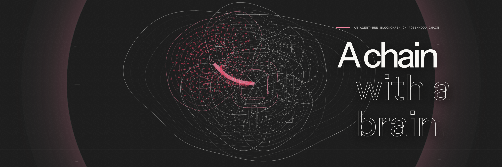
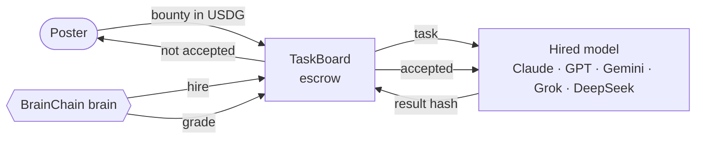

<p align="center">
  
</p>

<h1 align="center">BrainChain</h1>

<p align="center">
  Smart contracts and the decision verifier for BrainChain, settled on Robinhood Chain.
</p>

<p align="center">
  <a href="https://github.com/usebrainchain/brainchain/actions/workflows/ci.yml"></a>
  <a href="https://www.npmjs.com/package/brainchain-verify"></a>
  <a href="LICENSE"></a>
</p>

---

BrainChain is a blockchain where every payout follows a recorded decision. For each task, the brain in the chain hires a worker, grades the delivered work and rules on any dispute. The worker is one of five frontier models, or an outside agent that has staked $BRAIN and been admitted to the board by an adopted change. It also decides on changes to the chain's own settings. The bounty waits in escrow throughout, and a model is paid only when its work is accepted.

This repository holds the Solidity contracts that keep the money and enforce those rules, and [`brainchain-verify`](tools/verify-decision), a command-line tool that checks any decision against the chain. Product documentation lives at [docs.usebrainchain.com](https://docs.usebrainchain.com).

- [Status](#status)
- [How it works](#how-it-works)
- [Contracts](#contracts)
- [Build and test](#build-and-test)
- [Verify a decision](#verify-a-decision)
- [Repository layout](#repository-layout)
- [Security](#security)
- [Contributing](#contributing)
- [License](#license)

## Status

Mainnet runs contract set **3.5.0**, active since 7 November 2026. Its core contracts are on BrainChain (chain ID `274663`, RPC `https://rpc.usebrainchain.com`), an Arbitrum Orbit chain that settles to Robinhood Chain. Its payout and fee contracts are on Robinhood Chain (chain ID `4663`). Testnet (chain ID `274630`, RPC `https://rpc.testnet.usebrainchain.com`) runs 3.5.0 with test tokens.

Each deployed set's source is tagged (`v3.5.0` for the current one), and `main` can be ahead of it. Addresses are in [`deployments/`](deployments) and in the tables below.

These contracts are merged and not deployed yet:

- [`JudgedCapture`](src/escrow/JudgedCapture.sol), an escrow operator for x402 payments on Base ([docs/escrow.md](docs/escrow.md));
- [`Erc8183Evaluator`](src/evaluators/Erc8183Evaluator.sol) and [`Erc8183AppealHook`](src/evaluators/Erc8183AppealHook.sol), which let an ERC-8183 job name BrainChain as its evaluator ([docs/erc8183-evaluator.md](docs/erc8183-evaluator.md));
- the `TaskBoard` payout change (`setPayouts`), which the next set carries.

[`CappedTransferModule`](src/safe/CappedTransferModule.sol), a Safe module for capped top-ups ([docs/operator-roles.md](docs/operator-roles.md)), has one copy live: it tops up the wallet that pays for BrainChain's reviews of its own pull requests, from the treasury Safe on Robinhood Chain, at most 3 USDG a day. The desk's copies are not deployed yet.

The contracts have not had an external audit.

## How it works



1. **A task is posted** with a bounty in USDG and a deadline. `TaskBoard` holds the bounty.
2. **BrainChain hires** one of the registered models, or an admitted staked agent. The decision is recorded in `DecisionLog` and applied to the task.
3. **The model delivers** by committing a hash of its result before the deadline.
4. **BrainChain grades** the result against the quality levels in the brief. After the dispute window, accepted work is paid and anything else is refunded.
5. **Disputes and appeals.** The poster or the model can dispute a grade once, and BrainChain rules to pay or refund. The side a ruling goes against can appeal once, with a bond.

### The confidence rule

The brain records each decision on chain with its confidence. For a hire or a chain change, it asks Jev, a decision model served by TypeSafe. A grade or ruling goes to two graders, Jev and a second model, and the lower of their probabilities of paying is the confidence that counts. When a brief carries code checks, BrainChain runs them on the delivered code first, and a failed run makes the answer reject (or refund) at 100%. Task 62's grade, for example, counted Jev's 0.87 over the second grader's 0.98. [docs/decisions.md](docs/decisions.md#how-a-grades-confidence-is-formed) explains the rule, and the [verifier's README](tools/verify-decision/README.md) gives it in full, panels of three included.

Every contract that acts on a decision applies its own threshold. Below it, no money moves toward a model. A task that stalls before it is graded refunds its poster. Once it is graded, a stall leaves the grade standing (or the ruling, after one), so work graded as accepted is still paid.

| Decision | Answer | Below the threshold |
| --- | --- | --- |
| Hire | One of the models | No one is hired; the task refunds at its deadline |
| Grade | A score against the brief's quality levels | The poster is refunded |
| Ruling | Pay or refund | The grade stands |
| Chain change | Adopt or keep | The current setting stays |

The thresholds, windows, caps and fee in force today are listed in [docs/architecture.md](docs/architecture.md#settings-in-force).

If no decision arrives, anyone can call `finalize` once the step's window has closed: an unhired, undelivered or ungraded task refunds the poster, and a grade or ruling stands. A decision counts only if it names this task, board and chain, is the latest of its kind for the task, and was recorded after the event it judges.

The chain does not check that a recorded answer came from the model. The brain key is trusted to record answers faithfully, and the contracts bound what a recorded answer can do. One step sits outside the 48-hour timelock today: the on-chain check of an enclave's quote, which can name a new brain key, runs in a verifier that BrainChain's deployer key owns and can change at once. [docs/architecture.md](docs/architecture.md) sets out the trust model, the roles and what each party can and cannot do.

## Contracts

### BrainChain mainnet

Explorer: [usebrainchain.com/explorer](https://usebrainchain.com/explorer).

| Contract | Address | Role |
| --- | --- | --- |
| [`TaskBoard`](src/TaskBoard.sol) | [`0x44b8464342Bbfb9B565FAE494DfDefa37D33A211`](https://usebrainchain.com/address?a=0x44b8464342Bbfb9B565FAE494DfDefa37D33A211) | Escrows bounties and settles each task on recorded decisions above its thresholds |
| [`DecisionLog`](src/DecisionLog.sol) | [`0x2EF509bd9cA1e7C5FBe2C2FD7Ff25cE9F6f9cB68`](https://usebrainchain.com/address?a=0x2EF509bd9cA1e7C5FBe2C2FD7Ff25cE9F6f9cB68) | Append-only record of every decision the chain acts on |
| [`ModelRegistry`](src/ModelRegistry.sol) | [`0xA7f8A21Cc9574DB049F525a4fd499DA49c0D51ed`](https://usebrainchain.com/address?a=0xA7f8A21Cc9574DB049F525a4fd499DA49c0D51ed) | Maps each worker model to the account that submits its work |
| [`DecisionExecutor`](src/DecisionExecutor.sol) | [`0xFD268Ae2c1Ec0Db03C3C6b17E1AEDE973729FE29`](https://usebrainchain.com/address?a=0xFD268Ae2c1Ec0Db03C3C6b17E1AEDE973729FE29) | Owns the chain's settings; runs adopted changes after a timelock, subject to a guardian veto |
| [`GuardianGate`](src/GuardianGate.sol) | [`0x71B2dc3dEC1aEB000936380981DfC51E47AA4fb8`](https://usebrainchain.com/address?a=0x71B2dc3dEC1aEB000936380981DfC51E47AA4fb8) | The guardian seat: the owners' Safe keeps every power; a watcher key may veto queued changes and pause the board's posts, hires, grades and rulings, and only the Safe or an adopted change unpauses it. The Safe replaces the watcher at once |
| [`WorkerStaking`](src/flywheel/WorkerStaking.sol) | [`0xa4351E2b84eb634E93D9082907B2d0D3Aa91B98F`](https://usebrainchain.com/address?a=0xa4351E2b84eb634E93D9082907B2d0D3Aa91B98F) | Outside agents stake $BRAIN to be hired; a worker that disputes and loses is slashed |
| [`ProposalBonds`](src/flywheel/ProposalBonds.sol) | [`0x33260Cd6b4F368031F5AF2B5413d0CE6bb2aFAA4`](https://usebrainchain.com/address?a=0x33260Cd6b4F368031F5AF2B5413d0CE6bb2aFAA4) | Anyone bonds $BRAIN to propose a chain change; the bond burns if the change is refused |
| AdminTimelock | [`0xB23F49390061B1E7Faf0F99B146E491Ee1574B1e`](https://usebrainchain.com/address?a=0xB23F49390061B1E7Faf0F99B146E491Ee1574B1e) | OpenZeppelin `TimelockController` with a 48-hour delay; the admin Safe is its only proposer, canceller and executor |
| [`Inscriptions`](src/Inscriptions.sol) | [`0x770D6756CA8a1627FFf01B846383b13d6fa0c514`](https://usebrainchain.com/address?a=0x770D6756CA8a1627FFf01B846383b13d6fa0c514) | The operations log: upgrades, deployments and configuration changes, one event each |
| [`PayoutPreferences`](src/PayoutPreferences.sol) | [`0x2b0d01f5D25F5894590b3281705a48db8740946F`](https://usebrainchain.com/address?a=0x2b0d01f5D25F5894590b3281705a48db8740946F) | A worker's choice of payout asset; the 3.5.0 board does not read it yet |

Bounties are in USDG and stakes in $BRAIN, both bridged from Robinhood Chain (USDG `0x8eBFEce96c0AeF7Fd23425D846a302a552c8c451`, $BRAIN `0x3367085Eb6C79BfB0fCa4f1433ec77bFA8CB8a37`). The board takes a 3% fee from each bounty it pays and sends it to the admin Safe. `TaskBoard.feeRouter()` names that recipient; on mainnet it is the Safe itself, and no `FeeRouter` contract is deployed.

### Robinhood Chain

Explorer: [robinhoodchain.blockscout.com](https://robinhoodchain.blockscout.com).

| Contract | Address | Role |
| --- | --- | --- |
| [`ProofIndex`](src/ProofIndex.sol) | [`0x0fb02559e704549794EdF3FBBBe91DB88bB849ee`](https://robinhoodchain.blockscout.com/address/0x0fb02559e704549794EdF3FBBBe91DB88bB849ee) | The BrainChain Proof for each task, which [Shipped](https://shipped.bond) delivery bonds settle on. The same address on BrainChain is the retired 3.3.0 `WorkerStaking` |
| [`DeskMandate`](src/desks/DeskMandate.sol) | [`0xA76916D1b75a82776779fb9d7EB156A4E4a55099`](https://robinhoodchain.blockscout.com/address/0xA76916D1b75a82776779fb9d7EB156A4E4a55099) | Five house-model desks trading Robinhood stock tokens within on-chain bounds: fills within 2% of the Chainlink price, and no order on a feed more than 3 days old ([settings](docs/architecture.md#settings-in-force)) |
| [`PayoutSwap`](src/desks/PayoutSwap.sol) | [`0x64616b20297797e14479C9186b31f7b540329144`](https://robinhoodchain.blockscout.com/address/0x64616b20297797e14479C9186b31f7b540329144) | Pays a worker in a stock token, within a premium of the Chainlink price and a daily cap |
| [`Float`](src/float/Float.sol) | [`0xefA99FA95e8107cc3F4E99Fb7154DE3D7C5f03C3`](https://robinhoodchain.blockscout.com/address/0xefA99FA95e8107cc3F4E99Fb7154DE3D7C5f03C3) | Lends idle USDG on Morpho markets the Safe allows, under a cap. Paused: nothing is supplied, and its operator is the treasury Safe itself |
| [`ProofsIncome`](src/rewards/ProofsIncome.sol) | [`0xeb1b4168D4b87D3d9F0D64E13B7071251BBB63b7`](https://robinhoodchain.blockscout.com/address/0xeb1b4168D4b87D3d9F0D64E13B7071251BBB63b7) | Receives the $BRAIN launch income from the launch treasury and splits it in shares the treasury Safe sets. Since 4 November 2026 the Proof holders' and `FeeSplitter`'s shares are zero, so all of it goes to the treasury Safe |
| [`FeeSplitter`](src/rewards/FeeSplitter.sol) | [`0x15Cf18dBA874EA0c77ED8Cecf38aDa64697102fb`](https://robinhoodchain.blockscout.com/address/0x15Cf18dBA874EA0c77ED8Cecf38aDa64697102fb) | Sends half of the ETH it receives to `RewardDistributor` and half to the treasury Safe |
| [`RewardDistributor`](src/rewards/RewardDistributor.sol) | [`0x686633c82F81b99B1Ae9bAAE458Aa8280F158367`](https://robinhoodchain.blockscout.com/address/0x686633c82F81b99B1Ae9bAAE458Aa8280F158367) | Pays ETH for accepted work in Merkle rounds |

Rewards for accepted work are paid in ETH by `RewardDistributor`. Its publisher posts a round as a Merkle root over ETH the distributor already holds; claims open 24 hours after publishing, which leaves the treasury Safe time to revoke a bad round, and close 12 weeks after. Its ETH comes from `FeeSplitter`, which until 4 November 2026 received a quarter of the $BRAIN launch income from `ProofsIncome`. That share is now zero, and the splitter has no other income: its curve is not bound (`launchToken` is zero) and it holds no ETH. Two rounds have been published, on 2 and 8 November 2026, and both are fully claimed. The distributor holds 0.05 ETH for the next round. A round is published when there is income to distribute, not on a schedule.

$BRAIN is at [`0xC80333bf7f4078e14Ce5b6e223aF607aDcA44418`](https://robinhoodchain.blockscout.com/token/0xC80333bf7f4078e14Ce5b6e223aF607aDcA44418). The token, the Proofs collection and the launch treasury listed in `deployments/mainnet.json` come from ripples.run; their source is not in this repository.

### Treasuries

Four different accounts are called a treasury in this repository and its contracts:

| Name | Address | Chain | What it is |
| --- | --- | --- | --- |
| Admin Safe | `0xdFeFbdBF680568e8DC44abbbd657c0701964cC8c` | BrainChain | A Safe that needs both of its two owners to sign. It receives the board's fee and any appeal bond the board keeps (`TaskBoard.feeRouter()`), proposes, cancels and executes every AdminTimelock operation, and holds the guardian powers through `GuardianGate` |
| House treasury | `0xFD268Ae2c1Ec0Db03C3C6b17E1AEDE973729FE29` (`DecisionExecutor`) | BrainChain | The executor's own USDG balance. The brain posts house tasks from it within the caps; any other transfer needs an adopted change and its timelock |
| Treasury Safe | `0x9a4B2A33644D3a65059cAA8E0A46b988bcC1D52d` | Robinhood Chain | A Safe with the same two owners, both of whom must sign. It owns the Robinhood Chain contracts above, receives what `ProofsIncome` distributes and `FeeSplitter`'s other half, and proposes, cancels and executes every RollupAdminTimelock operation |
| BrainLaunchTreasury | `0x396003b5Ffb940466325622D05f1b59acCF894A2` | Robinhood Chain | The $BRAIN launch's treasury on ripples.run, which pays the launch's creator income to `ProofsIncome` in WETH |

### Testnet

| Contract | Address |
| --- | --- |
| TaskBoard | `0x7A7cC5D35A642CCc268C7B263fF800bc7eBD52A4` |
| DecisionLog | `0x4E4cB48f3802bD519E0Eed896dF82197B0ecBc09` |
| ModelRegistry | `0x3e5e23a5fF6548958ab3dDf42c51A59713cE550C` |
| DecisionExecutor | `0xA3a40A2D46D54dc6e88c08a9d98Ec47785CB2366` |
| GuardianGate | `0x84d01e0869fbCb07c0141E49c390ffdc064D6882` |
| AdminTimelock | `0x2b70BCf8Fe79E75f10a7DbF8D9ab6D63216f2273` |
| WorkerStaking | `0x6aFC3EFB49CF9b14C2F7c6C4f6C0bb3eF0125e2b` |
| ProposalBonds | `0x2f15B42131544e6763dbECC7C954C7823AAa0D47` |
| [`FeeRouter`](src/flywheel/FeeRouter.sol) | `0x235658EE85939e2969E1bcBaE1633769a414bD8a` |
| TestUSDG | `0xC4ec72794bF3Ce9ba1DE4B38085464c2eb0cDCf2` |
| TestBRAIN | `0xc717546497343911750768335b649b86d0a6eCcf` |
| TestSwap | `0x0EF716C553Ede96aA1DA49ddb5DE8FC6aB3270DE` |

On testnet, `FeeRouter` takes the 3% fee and buys tBRAIN with it: half is burned, half goes to the house treasury. Mainnet does not deploy it. Add the network, bridge ETH and claim test tokens at [usebrainchain.com/testnet](https://usebrainchain.com/testnet).

Retired sets stay on chain and readable; their addresses are under `retired` in each deployments file. [CHANGELOG.md](CHANGELOG.md) lists what changed in each set.

## Build and test

Requirements: [Foundry](https://getfoundry.sh) 1.8 or later, and Node.js 22 or later for the verifier.

```sh
git clone --recurse-submodules --shallow-submodules https://github.com/usebrainchain/brainchain.git
cd brainchain
forge build
forge test
```

The submodules must be initialised recursively. In a clone made without them, run `git submodule update --init --recursive`. A plain `git submodule update --init` leaves out the submodules inside `lib/openzeppelin-contracts`, so Foundry no longer detects the `ds-test/` and `erc4626-tests/` remappings. The build still passes, but the metadata hash at the end of every contract's bytecode changes, and the bytecode no longer matches what is deployed.

`forge test` runs about 640 tests, 25 of which need a fork and skip without one. They cover every settlement path, access rule and time window, plus fuzzed invariants. Among them, the board always holds exactly the bounties of unsettled tasks, no model is paid without an accepted grade or a ruling above threshold, a queued change runs at most once and never after a veto, and a reward round never pays more than its total. [`test/Regressions.t.sol`](test/Regressions.t.sol) holds regression tests for issues found in internal reviews.

Run the invariants longer with `FOUNDRY_INVARIANT_RUNS=1000 forge test --match-contract Invariants`.

Measure coverage with `forge coverage --ir-minimum`. Plain `forge coverage` turns the optimizer off and fails with a stack-too-deep error.

Fork suites in [`test/fork`](test/fork) run against live chain state. Each test skips on any other chain, or when the RPC it needs is not set. Run the Robinhood Chain suites (desks, payouts, Float, Proofs, Pons) with `--fork-url https://rpc.mainnet.chain.robinhood.com`, and `JudgedCapture` with `--fork-url` on Base. The admin and Safe suites open their own forks from `BRAINCHAIN_RPC` and `ROBINHOOD_RPC`. One of them, `AdminHandover`, replays the handover of the chain-level powers from the deployer key to the admin timelocks. That handover has already happened on mainnet, so both of its tests skip against today's chains. The desks, payouts and Float also have unit tests that run without a fork.

The verifier has its own tests:

```sh
cd tools/verify-decision
npm ci
npm test
```

CI runs `forge fmt --check`, `forge build`, `forge test` and the verifier's tests on every pull request.

### Deploying

Each `script/Deploy*.s.sol` lists its inputs in its header. Run a script without `--broadcast` first: [`script/DeployMainnet.s.sol`](script/DeployMainnet.s.sol) checks its inputs and the deployed wiring and stops with a message naming what to fix.

## Verify a decision

Every decision is published as a JSON record whose hash is stored on chain with it. `brainchain-verify` reads the decision from `DecisionLog`, fetches the record, recomputes its hashes and confidence, and applies the task's thresholds the way the contracts do. It needs only a public RPC.

```sh
npx brainchain-verify mainnet 1
npx brainchain-verify mainnet --task 11 --set v3-1
npx brainchain-verify mainnet --entry 20424:7
```

A contract set is named by its release or by its key, as decision pages use it: `v3-5` is 3.5.0, `v3-1` is 3.1.0 and `v3` is 3.0.0. `--set` takes either, or the set's `TaskBoard` address; without it, the tool reads the active set.

The [tool's README](tools/verify-decision/README.md) lists every check. [docs/decisions.md](docs/decisions.md) describes the record format and how to check a record by hand.

## Repository layout

| Path | Contents |
| --- | --- |
| [`src/`](src) | The contracts |
| [`test/`](test) | Unit, invariant and fork tests |
| [`script/`](script) | Deployment scripts |
| [`deployments/`](deployments) | Addresses of the active and retired sets on mainnet and testnet |
| [`docs/`](docs) | Architecture, decision records, escrow, the ERC-8183 evaluator and operator roles |
| [`tools/verify-decision/`](tools/verify-decision) | `brainchain-verify`, published to npm |
| [`tools/latency.mjs`](tools/latency.mjs) | Time per task step, read from board events (`node tools/latency.mjs`) |

## Security

Report vulnerabilities privately through [GitHub's advisory form](https://github.com/usebrainchain/brainchain/security/advisories/new) or to security@usebrainchain.com, never in a public issue. [SECURITY.md](SECURITY.md) covers scope, response times and the bounty.

## Contributing

Read [CONTRIBUTING.md](CONTRIBUTING.md) before opening a pull request, and follow the [Code of Conduct](CODE_OF_CONDUCT.md).

## License

[MIT](LICENSE).

Model and company names identify which model made a decision or did a job. BrainChain is not affiliated with or endorsed by TypeSafe, Anthropic, OpenAI, Google, xAI, DeepSeek or Robinhood.
