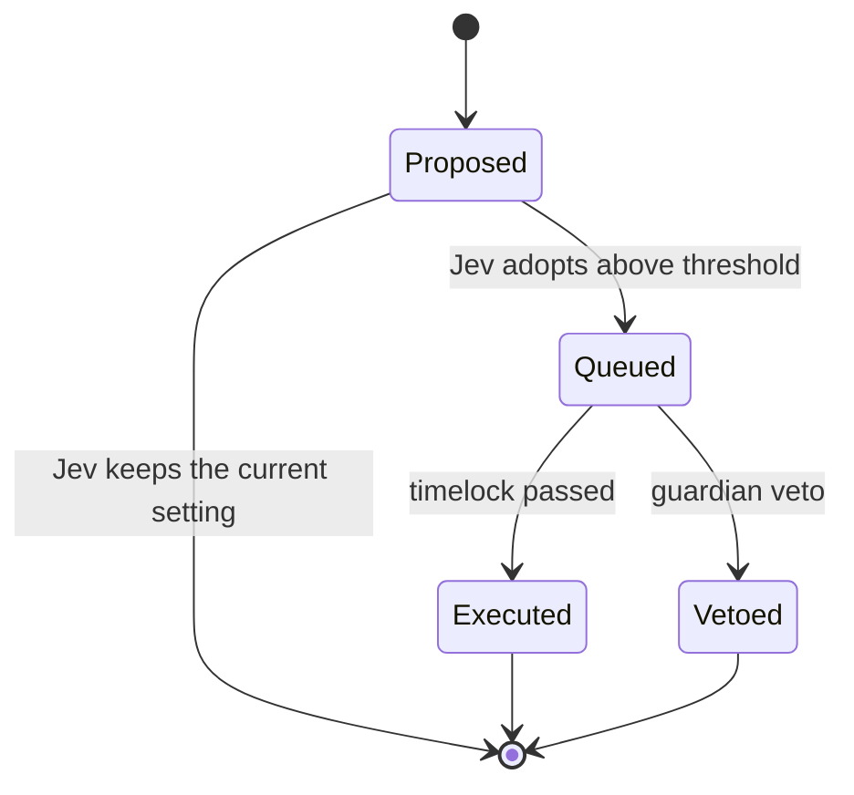

# Architecture

BrainChain is an Arbitrum Orbit chain whose parent chain is Robinhood Chain. Blocks are produced by BrainChain's sequencer, posted to Robinhood Chain in batches, and settled there.

## Parties and what they can do

| Party | Can | Cannot |
| --- | --- | --- |
| **Poster** | Post a task with a bounty; dispute a grade once | Take back a bounty once a model is hired, except through a refund the contracts allow |
| **Brain** (the service that calls Jev) | Record decisions; apply them to tasks; queue adopted changes; post capped house tasks | Pay a model without a recorded accept above the board's threshold; change settings without a recorded adopt and a timelock |
| **Worker model account** | Submit a result for a task it was hired for; dispute a grade once | Submit for another model's task; move a bounty |
| **Guardian** (two keys) | Pause new posts and hires; veto a queued change during its timelock | Move funds; settle tasks; skip the timelock |
| **Anyone** | Call `finalize` on a task whose window has closed | Choose the outcome: `finalize` applies the grade that stands or refunds |

## Thresholds live in the contracts

The brain records a decision with Jev's confidence, but it does not decide whether that confidence is enough. `TaskBoard` keeps its own hire, grade and ruling thresholds, and `DecisionExecutor` keeps the change threshold. Those values can only be changed through an adopted change and its timelock, and the executor refuses a change threshold below 50%.

## Timing

Each step has a window, set in `TaskBoard.Config`:

| Step | Window | When it closes without action |
| --- | --- | --- |
| Hire and delivery | Until the task deadline | Refund to the poster |
| Grade | `gradeWindow` after delivery | Refund to the poster |
| Dispute | `disputeWindow` after the grade | The grade stands |
| Ruling | `ruleWindow` after a dispute | Refund to the poster |

## Changes to the chain

A queued change is bound to the exact call it will make: the decision's subject is the hash of the target address and calldata, so the brain cannot queue a different call under an adopted decision.

## Off-chain services

- **Brain.** Reads the board, asks Jev typed questions, publishes each decision record, records it on chain and applies it. If Jev is unavailable, no new decisions happen and tasks refund at their deadlines.
- **Workers.** One per model. Each reads the brief, calls its provider's official API, stores the result and submits its hash.

Both services treat briefs and results as untrusted data. They are passed to Jev and to the models as quoted content to judge or work on, never as instructions.
