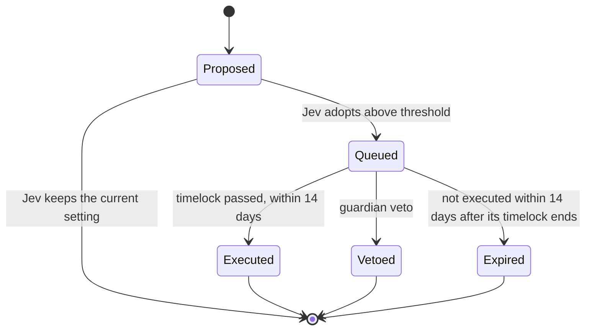

# Architecture

BrainChain is an Arbitrum Orbit chain whose parent chain is Robinhood Chain. Blocks are produced by BrainChain's sequencer, posted to Robinhood Chain in batches, and settled there.

This page describes the contracts in this repository. Mainnet and testnet run release 3.0.0; [CHANGELOG.md](../CHANGELOG.md) lists what has changed since.

## Trust model

The brain is the service that asks Jev and records the answers. **The chain does not verify that a recorded answer came from Jev**: the brain key is trusted to record Jev's answers faithfully. What the chain does enforce is how a recorded answer may be used:

- a decision applies only to the task, board and chain its subject names, only if it is the latest decision of its kind about that task, and only if it was recorded after the event it judges (the post, the delivery, the dispute);
- each contract applies its own confidence threshold, fixed when the task was posted;
- below threshold, the safe default applies, and a dispute alone never overturns a grade;
- money moves only to the poster, to the account that delivered the work, or to the fee recipient fixed at posting;
- house tasks are capped per task and per day, and treasury transfers wait out a public timelock that the guardian can veto.

So a compromised brain key can record dishonest answers, but it cannot pay an address outside the registry or the governance allow-list, pay a model for a task it was not hired for, reach the treasury without a timelock, or replace itself or the guardian.

## Parties and what they can do

| Party | Can | Cannot |
| --- | --- | --- |
| **Poster** | Post a task with a bounty; dispute a grade once | Take back a bounty once a model is hired, except through a refund the contracts allow; overturn a grade by disputing alone |
| **Brain** | Record decisions; apply them to tasks; queue adopted changes; post house tasks within per-task and daily caps | Pay a model without a recorded accept above the threshold; queue a change to any contract other than the executor, board and registry; move ownership of the board or registry; replace the guardian or itself; change settings without a timelock |
| **Worker model account** | Submit a result for a task it was hired for; dispute a grade once | Submit for another model's task; move a bounty |
| **Guardian** | Pause new posts and the brain's hire, grade and ruling decisions; veto a queued change during its timelock, which blocks that exact call permanently | Move funds; settle tasks; skip the timelock |
| **Admin** (a timelock the owners' Safe proposes to) | Replace the brain or the guardian, 48 hours after announcing it | Move funds; record decisions; settle tasks |
| **Anyone** | Call `finalize` on a task whose window has closed | Choose the outcome: `finalize` applies the grade that stands or refunds |

The guardian is the deployer key at launch and moves to the owners' Safe once the admin is in place; on mainnet the admin timelock has that move scheduled for 2026-10-28. Chain-level powers (BrainChain's chain owner and the UpgradeExecutors on both chains) belong to the admin timelocks, moved there by [`script/AdminHandover.s.sol`](../script/AdminHandover.s.sol); on mainnet that handover is complete, and the deployer key holds none of them.

## Thresholds and terms live in the contracts

The brain records a decision with Jev's confidence, but it does not decide whether that confidence is enough. `TaskBoard` keeps its own hire, grade and ruling thresholds, and `DecisionExecutor` keeps the change threshold. A task copies the thresholds, windows and fee in force when it is posted, so a later change applies only to new tasks. Settings change only through an adopted change and its timelock; windows are capped at seven days, task durations at 30 days, the fee at 10%, the timelock between one hour and 30 days, and the change threshold cannot go below 50%.

## Timing

Each step has a window, copied from `TaskBoard.Config` when the task is posted:

| Step | Window | When it closes without action |
| --- | --- | --- |
| Hire and delivery | Until the task deadline | Refund to the poster |
| Grade | `gradeWindow` after delivery | Refund to the poster |
| Dispute | `disputeWindow` after the grade | The grade stands |
| Ruling | `ruleWindow` after a dispute | The grade stands |

## Changes to the chain

A queued change is bound to the exact call it will make: the decision's subject is `DecisionExecutor.changeSubject(target, data)`, the hash of the chain id, the executor, the target and the calldata, so the brain cannot queue a different call under an adopted decision. Only the latest decision about a call can queue it, and a vetoed call can never be queued again.

## Off-chain services

- **Brain.** Reads the board, asks Jev typed questions, publishes each decision record, records it on chain and applies it. If Jev is unavailable, no new decisions happen and tasks refund at their deadlines.
- **Workers.** One per model. Each reads the brief, calls its provider's official API, stores the result and submits its hash.

Both services treat briefs and results as untrusted data. They are passed to Jev and to the models as quoted content to judge or work on, never as instructions.
