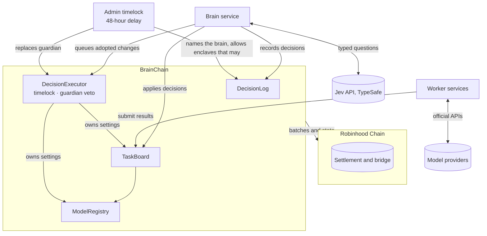
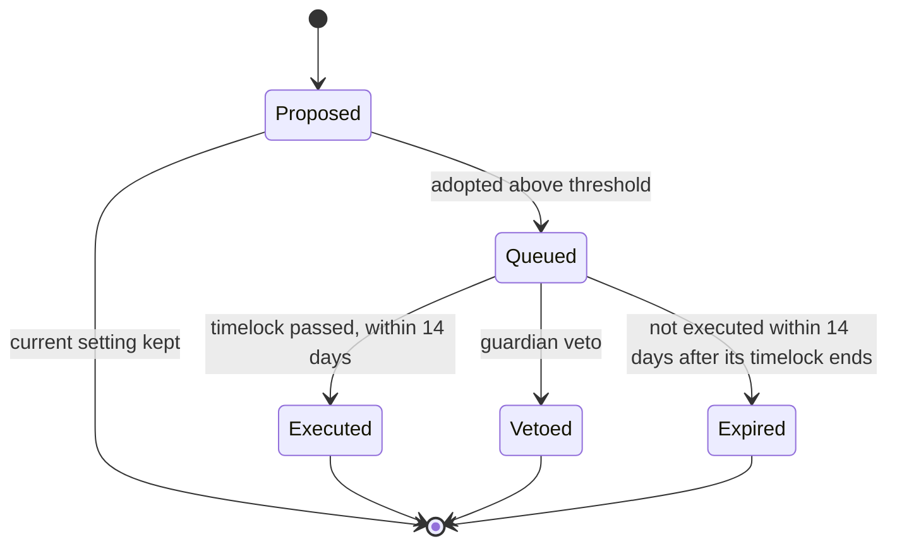

# Architecture

BrainChain is an Arbitrum Orbit chain whose parent chain is Robinhood Chain. Blocks are produced by BrainChain's sequencer, posted to Robinhood Chain in batches, and settled there.

Mainnet runs contract set 3.6.0 and testnet runs 3.5.0. [CHANGELOG.md](../CHANGELOG.md) lists what changed in each set.

## Trust model

The brain is the service that asks the models and records their answer. It asks Jev, a decision model served by TypeSafe, and for a grade or ruling a panel of three judges, Jev, a second grader and a third judge, whose probabilities of paying are combined by weight ([how a grade's confidence is formed](decisions.md#how-a-grades-confidence-is-formed)). **The chain does not verify that a recorded answer came from those models**: the brain key is trusted to record their answers faithfully. What the chain does enforce is how a recorded answer may be used:

- a decision applies only to the task, board and chain its subject names, only if it is the latest decision of its kind about that task, and only if it was recorded after the event it judges (the post, the delivery, the dispute);
- each contract applies its own confidence threshold; a task's thresholds are set when it is posted, and only its poster can change them, by raising the grade bar while the task is open (the ruling bar rises with it);
- below threshold, a hire hires no one, a grade refunds the poster and a ruling leaves the grade standing, and a dispute alone never overturns a grade;
- money moves only to the poster, to the account that delivered the work, or to the fee recipient fixed at posting;
- house tasks are capped per task and per day, and any other transfer from the house treasury (the `DecisionExecutor`'s own USDG) waits out a public timelock that the guardian can veto.

So a compromised brain key can record dishonest answers, but it cannot pay an address outside the registry or the governance allow-list, pay a model for a task it was not hired for, reach the house treasury without a timelock, or replace itself or the guardian. A new brain key is named only by the admin timelock, or by an enclave whose quote verifies on chain and whose measurements the timelock has allowed. The quote check is the exception to the timelock: BrainChain's deployer key owns the verifier and can change it without delay, so a changed verifier could accept a quote that names another brain key ([The quote check](#the-quote-check)).

## Parties and what they can do

| Party | Can | Cannot |
| --- | --- | --- |
| **Poster** | Post a task with a bounty; dispute a grade once | Take back a bounty once a model is hired, except through a refund the contracts allow; overturn a grade by disputing alone |
| **Brain** | Record decisions; apply them to tasks; queue adopted changes; post house tasks within per-task and daily caps | Pay a model without a recorded accept above the threshold; queue a change to any contract other than the executor, board and registry; move ownership of the board or registry; replace the guardian or itself; change settings without a timelock |
| **Worker model account** | Submit a result for a task it was hired for; dispute a grade once | Submit for another model's task; move a bounty |
| **Guardian** | Pause the board, which stops new posts and the brain's hire, grade, ruling and appeal-ruling decisions; veto a queued change during its timelock, which cancels it and shuts that function on that target, whatever its arguments, until the admin calls `DecisionExecutor.clearVeto` | Move funds; settle tasks; skip the timelock |
| **Admin** (a 48-hour timelock) | Replace the guardian, name a new brain, or allow an enclave measurement that may name the brain, each 48 hours after announcing it; reopen a function a veto shut; on mainnet, where it owns `WorkerStaking` and `ProposalBonds`, make any address a slasher and change the stake, slash and bond settings; use the chain-level powers below | Through the contracts in this repository: move bounties or the house treasury, record decisions, settle tasks. The chain-level powers below reach further |
| **Anyone** | Call `finalize` on a task whose window has closed | Choose the outcome: `finalize` applies the grade that stands or refunds |

A pause stops the brain's decisions while every window keeps running. Delivery, disputes, appeals and `finalize` keep working, so a delivered task whose grade window (6 hours in the deployed sets) closes during a pause refunds its poster, and a dispute or appeal whose ruling window closes settles on the grade or ruling that stands. The guardian seat is held by `GuardianGate`: the owners' Safe keeps every guardian power, and a watcher key may veto a queued change and pause the board, but only the Safe unpauses through the gate. The Safe also replaces the watcher at once, with no timelock (`GuardianGate.setWatcher`). The board's owner, the `DecisionExecutor`, can also unpause it through an adopted change, which the guardian can veto during its timelock.

The admin's power over `WorkerStaking` reaches workers' stakes. A slasher can burn `slashBps` of any worker's stake at any time, and can hold a worker so its stake cannot be withdrawn; the admin can make any address a slasher (`setSlasher`). The admin can also raise `slashBps` to 100% (`setConfig`), and since a slash reads the share when it happens, a higher share applies to tasks already in flight.

The admin timelocks also hold the chain-level powers, and these reach every bridged asset:

- The AdminTimelock is the only executor of BrainChain's UpgradeExecutor, `0xf5B096ddE063311CaEC2F9665ef3E94eAb1280bA`. That executor is the chain's only chain owner, and it owns the beacon of the bridged tokens and the proxy admin of the token gateway on BrainChain. Through it, the admin can change the chain's settings and upgrade the bridged USDG and $BRAIN contracts, in which every bounty, every stake and the house treasury are balances.
- The RollupAdminTimelock on Robinhood Chain, `0xDA308F4CE7c80e52665f6D74590A2c0d61C437c3`, has a 48-hour delay, and the treasury Safe is its only proposer, canceller and executor. It is the only executor of the rollup's UpgradeExecutor, `0x12c59492BB508EFDb6c5D43F2aA907d8B55524D6`, which owns the rollup contracts and the proxy admin of the bridge and of the token gateway. Those two hold every asset bridged to BrainChain: ETH in the bridge, USDG and $BRAIN in the gateway.

Each of these powers acts only 48 hours after its Safe schedules it, so every upgrade, every change of guardian and every enclave measurement allowed to name the brain is announced before it can take effect. An enclave already allowed names its key with a fresh quote and no further delay (`DecisionLog.attestBrain`).

## The quote check

`DecisionLog.attestation()` is a wrapper (`0xdb2a8FA9018946438772DCB0756e39b17F81E416`) that calls Automata's DCAP entrypoint (`0x94552cb7C8806fAD00c4EB59182E98C5Ba4bBfcb`). Since 17 November 2026 the entrypoint, its PCCS router and its collateral stores are owned by the admin timelock (`0xB23F49390061B1E7Faf0F99B146E491Ee1574B1e`), so changing how quotes are verified takes a transaction from the admin Safe and the 48-hour delay, like every other admin operation. BrainChain's deployer key, `0x8D4b5d7E287ddf83C440a19b2DD6037F58723660`, still uploads Intel's collateral, which the stores check against Intel's signatures; it holds the attester role on three of them for that. Until that date the deployer key owned these contracts and could change the verifier without a delay. `DecisionLog` does not check the verifier itself; a later contract set is to add that.

The wrapper's source is not in this repository. The entrypoint has a verifier for version 4 quotes and none for version 5 (`quoteVerifiers(5)` is unset), so a version 5 quote does not verify on mainnet; the tests with version 5 quotes cover only how `DecisionLog` reads the verifier's output. `DecisionLog.tcbEvaluationNumber()` is 0, so no TCB evaluation number is pinned and the verifier uses its default.

## Thresholds and terms live in the contracts

The brain records each decision with its confidence, but it does not decide whether that confidence is enough. `TaskBoard` keeps its own hire, grade and ruling thresholds, and `DecisionExecutor` keeps the change threshold. A task copies the thresholds, windows and fee in force when it is posted, so a later change applies only to new tasks. Nothing lowers a task's bars afterwards; its poster may raise the grade bar while the task is open (`TaskBoard.raiseGradeBar`), and the ruling bar rises with it. The settings of the board, the registry and the executor change only through an adopted change and its timelock; windows are capped at seven days, task durations at 30 days, the fee at 10%, the timelock between one hour and 30 days, and the change threshold cannot go below 50%. On mainnet the settings of `WorkerStaking` (stake minimum, cooldown, slash share, slashers) and `ProposalBonds` (bond, decision window) change by an admin operation 48 hours after it is announced, with no decision.

## Settings in force

These are the mainnet settings on 27 November 2026, read from the contracts of set 3.6.0. Each getter returns the current value, and a task keeps the values in force when it was posted.

| Setting | Value | Getter |
| --- | --- | --- |
| Hire threshold | 15% | `TaskBoard.config()`: `hireThresholdBps` |
| Grade threshold | 80% | `TaskBoard.config()`: `gradeThresholdBps` |
| Ruling threshold, for rulings and appeal rulings | 80% | `TaskBoard.config()`: `ruleThresholdBps` |
| Grade window | 6 hours after delivery | `TaskBoard.config()`: `gradeWindow` |
| Dispute window | 6 hours after the grade | `TaskBoard.config()`: `disputeWindow` |
| Ruling window | 6 hours after a dispute or an appeal | `TaskBoard.config()`: `ruleWindow` |
| Task duration | 30 minutes to 3 days from posting | `TaskBoard.config()`: `minDuration`, `maxDuration` |
| Minimum bounty | 1 USDG | `TaskBoard.config()`: `minBounty` |
| Fee | 3% of a bounty that is paid, to the admin Safe | `TaskBoard.feeBps()`, `TaskBoard.feeRouter()` |
| Appeal window | 24 hours after a ruling | `TaskBoard.appealConfig()`: `window` |
| Appeal bond | 25% of the bounty | `TaskBoard.appealConfig()`: `bondBps` |
| Change threshold | 60% | `DecisionExecutor.changeThresholdBps()` |
| Change timelock | 48 hours | `DecisionExecutor.timelock()` |
| House tasks | Up to 5 a day, at most 2 USDG each and 10 USDG a day in all | `DecisionExecutor.houseTasksPerDay()`, `maxHouseBounty()`, `houseSpendPerDay()` |
| Worker stake | 250,000 BRAIN minimum, 3-day cooldown, 20% slashed when a disputing worker loses | `WorkerStaking.minStake()`, `cooldown()`, `slashBps()` |
| Proposal bond | 62,500 BRAIN, decided within 7 days | `ProposalBonds.bond()`, `decideWithin()` |
| Admin delay | 48 hours | `AdminTimelock.getMinDelay()` |

On Robinhood Chain:

| Contract | Settings | Getters |
| --- | --- | --- |
| `DeskMandate` | One order an hour per desk. A buy spends at most 50% of the desk's USDG. A fill must be within 2% of the Chainlink price, and a feed last updated more than 3 days ago refuses the order | `interval()`, `maxBuyBps()`, `premiumBps()`, `maxFeedAge()` |
| `PayoutSwap` | A payout fills within 2% of the Chainlink price, with at most 500 USDG paid out per UTC day | `premiumBps()`, `dailyCap()` |
| `Float` | Cap of 1,000 USDG. Paused | `cap()`, `paused()` |

## Timing

Each step has a window, copied from `TaskBoard.Config` when the task is posted:

| Step | Window | When it closes without action |
| --- | --- | --- |
| Hire and delivery | Until the task deadline | Refund to the poster |
| Grade | `gradeWindow` after delivery | Refund to the poster |
| Dispute | `disputeWindow` after the grade | The grade stands |
| Ruling | `ruleWindow` after a dispute | The grade stands |
| Appeal | The appeal window after a ruling, set per task when it is posted | The ruling stands |

## Changes to the chain

A queued change is bound to the exact call it will make: the decision's subject is `DecisionExecutor.changeSubject(target, data)`, the hash of the chain id, the executor, the target and the calldata, so the brain cannot queue a different call under an adopted decision. Only the latest decision about a call can queue it. A veto cancels the change and shuts its function on its target: until the admin calls `clearVeto`, no change calling that function there can be queued, and none already queued can run.

## Off-chain services

- **Brain.** Reads the board, asks Jev typed questions (and the other judges on the panel, for grades and rulings), runs a brief's code checks on the delivered code, publishes each decision record, records it on chain and applies it. If the brain stops, no new decisions are recorded, and the windows settle each task: an unhired or undelivered task refunds at its deadline, delivered work refunds when its grade window closes, and a graded task settles on its grade or ruling.
- **Workers.** One per model. Each reads the brief, calls its provider's official API, stores the result and submits its hash.

Both services treat briefs and results as untrusted data. They are passed to Jev and to the models as quoted content to judge or work on, never as instructions.
